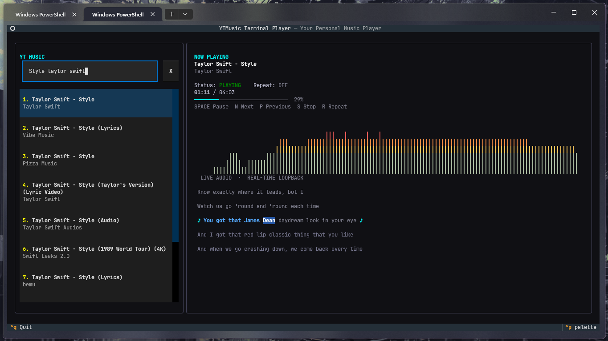
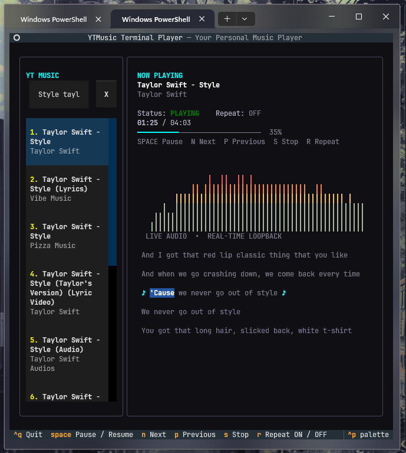

# XEN-TERMINAL

--Been working on my own YouTube Music Desktop Player!
So, I decided to build my own music player using Python in Terminal, and it's been quite challenging hahaha. It comes with YouTube Music search and playback, synchronized lyrics powered by LRCLIB and YouTube captions, and a real-time audio visualizer that moves along with the music.

It also has animated lyrics, playback controls, repeat functionality. MPV handles the music playback, while audio loopback captures the sound for the visualizer. I also spent time improving the interface and making the overall experience feel smoother and more enjoyable.

Still a work in progress, but I'm happy with how it's turning out so far😅. Lots of debugging, trial and error, and small improvements along the way hahaha. See less

